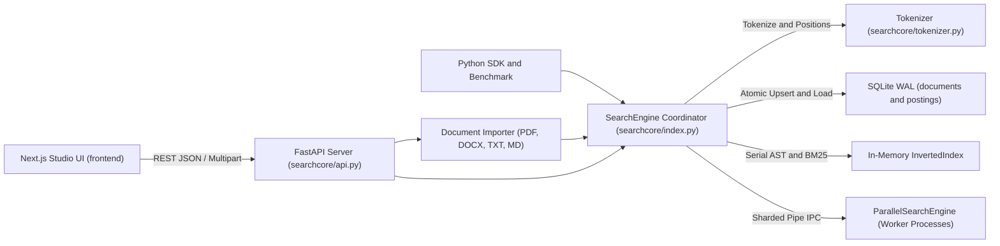

# SearchCore — Document Search Engine

A full-text document search engine built from scratch with **Python**, **FastAPI**, **SQLite (WAL)**, and a **Next.js 15 + Tailwind CSS v4 + Framer Motion** Studio UI.

SearchCore provides a positional inverted index, Okapi BM25 relevance ranking, a recursive-descent boolean and exact-phrase query parser, multi-format document extraction, transactional SQLite WAL persistence with startup snapshot recovery, and multi-process sharded parallel search.

---

## Table of Contents

- [Key Features](#key-features)
- [Architecture Overview](#architecture-overview)
- [Project Structure](#project-structure)
- [Prerequisites](#prerequisites)
- [Quickstart: Running Locally](#quickstart-running-locally)
- [Using the Studio UI](#using-the-studio-ui)
- [Query Syntax & Ranking](#query-syntax--ranking)
- [Python Library Usage](#python-library-usage)
- [HTTP API Reference](#http-api-reference)
- [Benchmarking](#benchmarking)
- [Configuration](#configuration)
- [Further Documentation](#further-documentation)

---

## Key Features

- **Positional Inverted Index** ([`searchcore/tokenizer.py`](searchcore/tokenizer.py), [`searchcore/index.py`](searchcore/index.py))
  - Applies Unicode NFKC normalization, lowercasing, and `[a-z0-9]+` tokenization.
  - Inserts a 1-slot position gap between `title` and `content` so exact phrase queries cannot accidentally span across title and body boundaries.
  - Protected by a re-entrant lock (`RLock`) and monotonic `version` counter for safe concurrency and worker shard synchronization.
- **Okapi BM25 Relevance Ranking** ([`searchcore/bm25.py`](searchcore/bm25.py))
  - Uses non-negative Robertson–Sparck Jones IDF and length-normalized TF scoring (`k1 = 1.5`, `b = 0.75` by default).
- **Boolean & Phrase Query Parser** ([`searchcore/query_parser.py`](searchcore/query_parser.py))
  - Recursive-descent AST parser (`TermNode`, `PhraseNode`, `NotNode`, `AndNode`, `OrNode`) supporting exact quoted phrases (`"inverted index"`), `AND`, `OR`, `NOT`, parentheses `(...)`, and configurable implicit default operator (`AND` or `OR`).
- **Multi-Format Document Ingestion** ([`searchcore/importer.py`](searchcore/importer.py))
  - Extracts searchable text from `.pdf` (`pypdf`), `.docx` (`python-docx`, paragraphs and tables), `.txt`, `.md`, `.csv`, `.json`, and `.log` files.
  - Supports multipart HTTP uploads, single-file imports, and recursive server-side directory imports (with automatic title extraction from leading Markdown headings or filename stems).
- **SQLite WAL Persistence & Restart Recovery** ([`searchcore/storage.py`](searchcore/storage.py))
  - Persists documents and positional postings across `documents` and `postings` tables using `PRAGMA journal_mode=WAL`, `PRAGMA synchronous=NORMAL`, and `PRAGMA foreign_keys=ON`.
  - Supports atomic upserts by `external_id`, batch transactions, updates, cascading deletes, automatic startup snapshot recovery (`recover()`), and full re-tokenization (`rebuild_index()`).
- **Multi-Process Parallel Search** ([`searchcore/parallel.py`](searchcore/parallel.py))
  - `ParallelSearchEngine` spawns dedicated OS worker processes (`spawn` context) sharded by `doc_id % num_workers` and communicates over `multiprocessing.Pipe`.
  - Synchronizes corpus-wide statistics (`N`, `avg_doc_length`, global term `df`, and two-phase `COUNT_PHRASES` global phrase `df`) so parallel BM25 rankings match serial execution.
- **Multi-Occurrence Snippets & Next.js Studio UI** ([`searchcore/index.py`](searchcore/index.py), [`frontend/`](frontend/))
  - Extracts merged context excerpts across all query matches (`match_count`, `snippets`).
  - Interactive **Next.js 15 + Framer Motion** frontend with drag-and-drop uploads, server folder import, syntax insertion chips, `Serial` / `Parallel` mode toggle, pagination (`10` / `25` / `50`), and a full-document match-jumper modal.

---

## Architecture Overview



See [`docs/ARCHITECTURE.md`](docs/ARCHITECTURE.md) for BM25 formulas, query evaluation precedence, SQLite schema definitions, and two-phase parallel search details.

---

## Project Structure

```text
.
├── searchcore/                        # Core Python package & FastAPI backend
│   ├── __init__.py                    # Public Python API exports
│   ├── tokenizer.py                   # NFKC normalization + positional tokenizer
│   ├── bm25.py                        # Non-negative IDF & Okapi BM25 scoring
│   ├── query_parser.py                # Recursive-descent boolean & phrase AST parser
│   ├── index.py                       # InvertedIndex, SearchEngine, build_all_snippets()
│   ├── storage.py                     # SQLite WAL persistence (documents & postings)
│   ├── importer.py                    # PDF, DOCX, TXT, MD, CSV, JSON, LOG extractors
│   ├── parallel.py                    # Spawned worker shards + global BM25 parity
│   ├── benchmark.py                   # Synthetic ingest, recovery & latency benchmark
│   ├── api.py                         # FastAPI app, Swagger UI & static export serving
│   └── static/                        # Optional fallback static asset directory
├── frontend/                          # Next.js 15 + Tailwind CSS v4 + Framer Motion UI
│   ├── src/app/                       # App Router pages (/, /docs redirect, layout, CSS)
│   ├── src/components/                # SearchConsole, DocumentStudio, StatsStrip, Modals
│   ├── src/lib/                       # Typed FastAPI client & match highlight helpers
│   ├── next.config.ts                 # Configured with output: "export"
│   ├── package.json
│   └── README.md                      # Frontend-specific notes & scripts
├── docs/
│   └── ARCHITECTURE.md                # Internal formulas, pipeline & schema reference
├── pyproject.toml                     # Package metadata, dependencies & pytest config
├── requirements.txt                   # Runtime & test Python dependencies
└── README.md
```

---

## Prerequisites

- **Python** `3.10+`
- **Node.js** `18+` and **npm** (required for running or building the Next.js Studio UI)

---

## Quickstart: Running Locally

### 1. Set Up and Start the Python Backend

**Windows (PowerShell):**
```powershell
python -m venv .venv
.\.venv\Scripts\Activate.ps1
pip install -r requirements.txt
uvicorn searchcore.api:app --reload
```

**macOS / Linux:**
```bash
python3 -m venv .venv
source .venv/bin/activate
pip install -r requirements.txt
uvicorn searchcore.api:app --reload
```

*(Alternatively, install the package in editable mode with `pip install -e ".[dev]"`.)*

Once running:
- **FastAPI Base URL:** `http://127.0.0.1:8000`
- **Swagger Interactive API Docs:** `http://127.0.0.1:8000/docs`

### 2. Run the Next.js Studio UI (Development Mode)

Keep the FastAPI server running on port `8000`, then open a **second terminal**:

```bash
cd frontend
npm install
npm run dev
```

Open **`http://localhost:3000`** in your browser.

> **Note:** When served on ports `3000` or `3001`, [`frontend/src/lib/api.ts`](frontend/src/lib/api.ts) automatically routes API requests to `http://127.0.0.1:8000`. Set `NEXT_PUBLIC_API_BASE` to point to a custom backend URL.

### 3. Optional: Single-Server Mode (Serve Static Export from FastAPI)

To build the Next.js static export (`frontend/out/`) and serve the entire UI directly from FastAPI on `http://127.0.0.1:8000/`:

```bash
cd frontend
npm install
npm run build
```

When `frontend/out/index.html` and `frontend/out/_next/` exist, [`searchcore/api.py`](searchcore/api.py) automatically mounts `/_next` and serves the compiled Studio UI at `GET /`.

> **Important:** Without building `frontend/out/` (or adding a custom `searchcore/static/index.html`), `GET /` on FastAPI will not have an HTML file to serve—use the Next.js dev server (`http://localhost:3000`) or Swagger UI (`http://127.0.0.1:8000/docs`) during development.

---

## Using the Studio UI

1. **Index Documents** (`Document Studio` panel)
   - **Upload Docs**: Drag and drop or select `.pdf`, `.docx`, `.txt`, `.md`, `.csv`, `.json`, or `.log` files, or enter a local server folder path to recursively import documents.
   - **Add / Edit**: Create or update a document with `title`, `content`, optional `external_id` (upsert key), and validated JSON `metadata`.
   - **All Docs**: Browse, filter, inspect, edit, or delete stored documents, or trigger **Rebuild Index** from the header.
2. **Search & Inspect** (`Search Console` panel)
   - Press `Ctrl+K` (`Cmd+K` on macOS) or `/` to focus the search bar.
   - Use the syntax chips (`"exact phrase"`, `AND`, `OR`, `AND NOT`, `( )`), toggle default operator (`AND` / `OR`), switch between `Serial` and `Parallel` execution, and choose page size (`10` / `25` / `50`).
   - Expand all matching snippet excerpts directly on a hit card or click **Inspect** to open the **Document Inspector Modal** and jump between every highlighted match (`↑ Prev` / `↓ Next`).

---

## Query Syntax & Ranking

Operators are **case-sensitive** uppercase keywords (`AND`, `OR`, `NOT`). Precedence from highest to lowest is:

`(...)` / literals (`Term`, `"Phrase"`) > `NOT` > `AND` > `OR`

| Query Example | Behavior |
| :--- | :--- |
| `bm25 sqlite` | Requires both terms when default operator is `AND`; matches either when `OR` |
| `"inverted index"` | Exact adjacent phrase match verified against token position lists |
| `python AND sqlite` | Must satisfy both sub-expressions |
| `bm25 OR parallel` | Matches either sub-expression and sums BM25 contributions |
| `("search engine" OR sqlite) AND NOT draft` | Grouped boolean precedence excluding documents matching `draft` |
| `e-mail` | Multi-token unquoted terms automatically evaluate as an adjacent phrase (`"e mail"`) |

---

## Python Library Usage

```python
from searchcore import ParallelSearchEngine, SearchEngine, import_directory

# 1. Initialize engine (loads persisted SQLite snapshot if present)
engine = SearchEngine(db_path="my_index.db")

# 2. Add or upsert documents
engine.add_document(
    title="BM25 Overview",
    content="Okapi BM25 scores term frequency with document length normalization.",
    external_id="bm25-1",
    metadata={"topic": "ranking"},
)

# Optional: bulk-import a folder of .txt, .md, .pdf, .docx files
# import_directory(engine, "./documents", recursive=True)

# 3. Execute a serial search
response = engine.search('"term frequency" AND bm25', limit=10, default_operator="AND")
print(f"Found {response.total_hits} hits in {response.took_ms} ms")
for hit in response.hits:
    print(hit.doc_id, hit.score, hit.match_count, hit.title, hit.snippet)

# 4. Execute the same query across spawned worker processes
with ParallelSearchEngine(engine, num_workers=2) as parallel:
    p_response = parallel.search('"term frequency" AND bm25', limit=10)
    print(f"Parallel hits: {p_response.total_hits} in {p_response.took_ms} ms")

engine.close()
```

---

## HTTP API Reference

Interactive schemas and try-it-out endpoints are available at `http://127.0.0.1:8000/docs`.

| Method | Endpoint | Description |
| :--- | :--- | :--- |
| `GET` | `/` | Serves compiled Next.js UI (`frontend/out/index.html`) when built |
| `GET` | `/docs` | FastAPI Swagger UI |
| `GET` | `/health` | Service status, `total_documents`, and parallel worker state |
| `GET` | `/stats` | Corpus statistics (`total_documents`, `vocabulary_size`, `total_tokens`, `avg_doc_length`, `k1`, `b`, `index_version`, worker status) |
| `POST` | `/documents` | Create or upsert a document (`external_id` acts as upsert key) |
| `POST` | `/documents/batch` | Batch upsert multiple documents in one SQLite transaction |
| `POST` | `/documents/upload` | Multipart file upload (`files` field; supports `.pdf`, `.docx`, `.txt`, `.md`, `.csv`, `.json`, `.log`) |
| `POST` | `/documents/import-directory` | Recursively import supported files from a local server directory path |
| `GET` | `/documents` | List stored documents (`limit` 1–500, `offset` >= 0) |
| `GET` | `/documents/{doc_id}` | Fetch a document by numeric `doc_id` |
| `PUT` | `/documents/{doc_id}` | Update a document's title, content, and optional metadata |
| `DELETE` | `/documents/{doc_id}` | Delete a document from SQLite and the inverted index |
| `POST` | `/index/rebuild` | Re-tokenize all documents in SQLite and rebuild postings |
| `GET` / `POST` | `/search` | Execute a `serial` or `parallel` search (`q`, `limit`, `offset`, `operator`, `include_content`, `parallel`) |

### Example `curl` Requests

```bash
# Index a document
curl -X POST http://127.0.0.1:8000/documents \
  -H "Content-Type: application/json" \
  -d '{"title":"SQLite WAL","content":"Write-ahead logging enables concurrent reads.","external_id":"wal-1"}'

# Search with POST (supports parallel=true)
curl -X POST http://127.0.0.1:8000/search \
  -H "Content-Type: application/json" \
  -d '{"q":"\"write ahead\" AND sqlite","limit":10,"operator":"AND","parallel":false}'
```

---

## Benchmarking

Run the built-in synthetic benchmark to measure batch ingestion throughput, SQLite restart recovery time, exact serial-vs-parallel hit-count parity, and query latency percentiles (`mean`, `p50`, `p95`, `p99`):

```bash
python -m searchcore.benchmark --docs 2000 --iterations 20 --workers 2
```

CLI options:
- `--docs` (default `2000`): number of synthetic documents to generate and index
- `--iterations` (default `20`): repetitions over the 6-query benchmark suite
- `--workers` (default `2`): number of spawned worker processes for parallel search

---

## Configuration

| Variable / Parameter | Default | Description |
| :--- | :--- | :--- |
| `SEARCHCORE_DB` | `searchcore.db` | SQLite database file path used by [`create_app()`](searchcore/api.py#L170-L176) |
| `NEXT_PUBLIC_API_BASE` | `http://127.0.0.1:8000` (on ports `3000`/`3001`), same-origin otherwise | Backend base URL used by [`frontend/src/lib/api.ts`](frontend/src/lib/api.ts) |
| `create_app(db_path, enable_parallel, num_workers)` | `db_path=None`, `enable_parallel=False`, `num_workers=None` | Programmatic FastAPI factory; when `parallel=true` is requested on `/search`, workers are lazily started if not pre-warmed |

---

## Further Documentation

- [`docs/ARCHITECTURE.md`](docs/ARCHITECTURE.md) — Ranking math, tokenization boundaries, query AST evaluation, SQLite schema, and parallel shard protocol.
- [`frontend/README.md`](frontend/README.md) — Next.js Studio UI stack and frontend build instructions.
